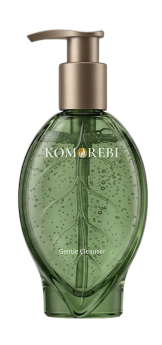

# Komorebi — Beauty, unnoticed.

A new, self-contained brand website built with plain HTML, CSS, and JavaScript. This is a fresh design, separate from the Figma prototype.

## Open and edit

Open `index.html` directly in your browser, or open the folder in VS Code and use Live Server. No npm install, framework, database, API key, or build command is needed.

- `index.html`: all content, image placeholders, navigation, team names, post captions, and accessible markup.
- `styles.css`: all styling, responsive layouts, typography, and animation. Brand colors and sizes are in `:root` near the top.
- `script.js`: intro, mobile menu, scroll progress, active section labels, reveal animations, logo tabs, post tabs, color-copy buttons, and artwork dialog.
- `assets/brand/`: supplied logo, wordmark, and dissection images.
- `assets/posts/`: your original first post and promotional poster.
- `assets/fonts/`: bundled open-source fonts and their licenses. No font-server requests are made by the finished site.

## GitHub → Vercel

1. Extract this ZIP. Put the contents of `komorebi-site` at the root of your GitHub repository (`index.html` should be visible at the repository root).
2. Import that repository into Vercel.
3. Use **Other** as the framework preset. Use the repository root as the root directory. There is no install or build step. If an output directory is requested, use `.`.
4. Deploy. Later commits to the connected deployment branch can redeploy the site.

This folder is a complete static site. It is also compatible with other static hosts. Hosting reference: https://vercel.com/docs/deployments/preparing-a-deployment

## Replace photo placeholders

Your requested placeholders remain in the hero, team portraits, and five product cards. The little bottle silhouettes are decorative illustrations, not actual product images.

Create `assets/photos/` and add your chosen images. Use lowercase filenames without spaces.

### Hero

Find the comment `Replace this div with an img` in `index.html`. Replace the entire `div.photo-placeholder.hero-photo` (including its botanical illustration and label) with:

```html

```

The arch shape and surrounding caption stay in place. `script.js` safely skips the botanical parallax if you remove the illustration.

### Team

Replace each complete `div.photo-placeholder.team-photo` with:

```html

```

Repeat for each member. Update the names below the portraits if desired.

### Products

Inside each `div.product-photo`, remove the decorative bottle and text, then insert:

```html

```

Keep the outer `.product-photo` container. Its CSS already fits the product image. Change `object-fit:contain` to `cover` if you prefer a full photographic crop.

## Animation controls

- Intro: `1700` milliseconds in `script.js`; fade timing is in `.intro` in CSS. The intro appears on each fresh page load, but is skipped for anchor deep links and reduced-motion users. Click **Enter quietly** or press Escape to skip.
- Smooth scrolling: `scroll-behavior` and `scroll-padding-top` on `html` in CSS.
- Reveal timing: `.motion-ready .reveal` near the bottom of CSS.
- Hero parallax: `updateScroll()` in JavaScript.
- Moving text strip: `.ticker > div` in CSS.
- The OS/browser **Reduce motion** preference disables the intro, ticker, parallax, smooth scrolling, and animated reveals.

## Typography and content notes

The website uses locally hosted **EB Garamond** and **Hanken Grotesk**. These are available alternatives for the requested Garamond / HK Gothic direction. The Brand and Posts sections describe the original artwork's typography; they do not claim that HK Gothic is bundled. To use your exact licensed fonts, add their WOFF2 files and replace the `@font-face` and font-family declarations.

Business copy and logo explanations are summarized from your supplied Business Concept and Logo Dissection PDFs. Team names come from the dissection document. No team roles beyond co-creator are invented.

The original logo's colors are Gold `#C8A020` and Eclipse `#3B3838`. The website uses the supplied cream/forest moodboard palette. The first-post swatches are clearly labeled as an interpretation, while the event swatches follow the supplied palette graphic (`#CBD9B0` as printed there).

The promotional poster is included as archive artwork. Its printed event details are not presented as a current/upcoming event. The products are shown as concepts; this site does not take orders or make clinical claims.

## Keyboard and fallback behavior

- Tab through navigation and controls. Arrow keys, Home, and End switch tab groups.
- Escape closes the artwork dialog and mobile menu.
- The mobile menu closes after choosing a section.
- Artwork dialogs contain focus through the browser's native dialog behavior and restore focus on close.
- Color copy works where clipboard access is available. Otherwise, the selected hex code is displayed.
- With JavaScript disabled, the story, brand identity, first post, footer, and anchor navigation remain readable; interactive enhancements require JavaScript.

## Verification

Checked JavaScript syntax, local asset references, desktop rendering, fixed navigation while scrolling, section anchors, logo tab changes, campaign tab switching, artwork enlargement, and the responsive menu. Native browser preview used the directly opened `index.html`.

No deployment has been created or connected to your GitHub/Vercel accounts. The files are ready for your own repository.
